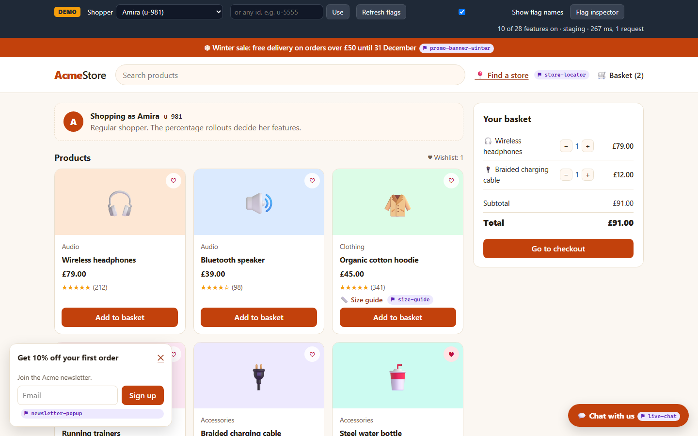
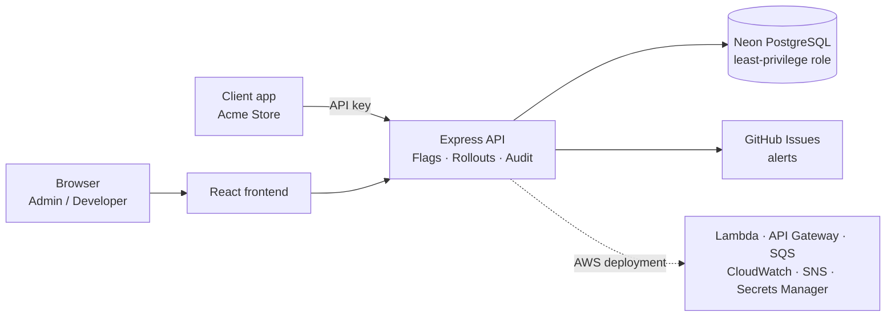

<div align="center">

# Feature Flag Manager

**Turn features on and off per environment, roll them out to a percentage of users, and audit every change, without redeploying.**

[](https://github.com/Kaliharfoosh/feature-flag-manager/actions/workflows/ci.yml)
[](https://feature-flag-manager-cyan.vercel.app)


[**Live app**](https://feature-flag-manager-cyan.vercel.app) ·
[**Demo store**](https://ffm-demo-shop.vercel.app) ·
[Architecture](docs/architecture.md) ·
[Threat model](docs/threat-model.md) ·
[API contract](docs/api-contract.md)

</div>

<p align="center">
  
  <br>
  <sub>The Acme Store demo client. Each purple tag is a live feature flag; switch shopper to see percentage rollouts and allow/block rules change what they get.</sub>
</p>

---

## Contents

- [Overview](#overview)
- [Features](#features)
- [Architecture](#architecture)
- [Tech stack](#tech-stack)
- [Getting started](#getting-started)
- [Testing and quality](#testing-and-quality)
- [Security](#security)
- [Project structure](#project-structure)
- [Documentation](#documentation)
- [Team](#team)

## Overview

The Feature Flag Manager is a multi-tenant web service built for **26CSCN29H Cloud Computing & Cloud
Security** (Group 21). Teams sign in to manage feature flags across `dev`, `staging` and `prod`;
their own applications ask the API *"is this flag on for this user?"* using an API key that is
scoped to one team and one environment.

The same codebase runs in two places:

| | Live (public) | AWS deployment |
|---|---|---|
| **Runs on** | Vercel: one function serving all three services, behind the Vercel Firewall | [Floci](infra/floci) (AWS emulator): S3 website, API Gateway, one Lambda per service |
| **Data** | Neon PostgreSQL | The same Neon database |
| **Secrets** | Vercel environment variables | AWS Secrets Manager, one secret per function |
| **Built by** | Git push to `main` (`vercel.json`) | Infrastructure-as-code scripts in [`infra/floci/services`](infra/floci/services/README.md) |

## Features

**Flag management**
- Create, toggle, archive and delete flags per environment, with role-based access (Admins change `prod`, Developers work in `dev` and `staging`)
- Shared sign-in with server-side sessions, CSRF protection and Cloudflare Turnstile
- Admin API key management: create environment-scoped keys, view safe prefixes, revoke access, and audit every change

**Rollouts and evaluation**
- Percentage rollouts with stable, deterministic user bucketing
- Allow and block rules for specific users, with a preview before saving
- `POST /evaluations` and `POST /evaluations/batch` (up to 50 flags in one request)
- Per-key rate limit of 120 requests/minute, shared across every function instance (`429` + `Retry-After`)

**Audit and monitoring**
- Every change is written to an append-only audit log in the same database transaction
- Audit log export, monitoring pages and security alerts (for example repeated failed logins)
- Alerts open GitHub issues; on AWS they flow through an SQS outbox with a dead-letter queue, CloudWatch metrics and SNS notifications, with scheduled jobs on EventBridge Scheduler

## Architecture



Both deployments start from `buildApp()` in [`backend/build-app.js`](backend/build-app.js): Vercel
mounts all three services in one function, while each Lambda mounts only its own service. Every
AWS integration is switched on by an environment variable, so the Vercel deployment runs without
any of them. Full diagrams, request flows and trust boundaries are in
[`docs/architecture.md`](docs/architecture.md).

## Tech stack

| Layer | Technologies |
|---|---|
| Frontend | React 19, React Router 7, Vite |
| Backend | Node.js 22+, Express 5, zod, Helmet, express-session, csrf-sync, pino |
| Data | PostgreSQL (Neon), connect-pg-simple, SQL migrations |
| Cloud | Vercel (Functions, Firewall); AWS via Floci: Lambda, API Gateway, S3, Secrets Manager, SQS, SNS, CloudWatch, EventBridge Scheduler, IAM |
| Quality | Jest, Supertest, k6, GitHub Actions, gitleaks, `npm audit` |

## Getting started

**Prerequisites:** Node.js 22 or newer, Git, and a PostgreSQL database (Neon, or a local Docker container).

```bash
git clone https://github.com/Kaliharfoosh/feature-flag-manager.git
cd feature-flag-manager
npm install
npm --prefix frontend install
cp .env.example .env        # fill in the values (only the names are committed)
```

Generate a session secret:

```bash
node -e "console.log(require('crypto').randomBytes(32).toString('hex'))"
```

Then set up the database and start both apps:

```bash
npm run migrate    # applies backend/db/migrations/*.sql once each
npm run seed       # demo teams, users and flags (needs SEED_PASSWORD in .env)
npm run dev:api    # API on http://localhost:3000
npm run dev:web    # frontend on http://localhost:5173 (proxies /api to :3000)
```

Open http://localhost:5173/api/v1/health and expect `{"status":"ok","db":"ok",...}`.

<details>
<summary>More scripts</summary>

| Script | What it does |
|---|---|
| `npm test` | Jest unit, API and database tests |
| `npm run seed:demo` | The Acme Store's flags and rules |
| `npm run seed:key` | Prints one API key (`npm run seed:key -- prod` for another environment) |
| `npm run build:lambda` | Builds the Lambda zip for Floci |
| `npm run check:envs` | Asks the live API with dev, staging and prod keys side by side (keys in the git-ignored `.env.envcheck`) |

</details>

## Testing and quality

- **Automated tests:** Jest and Supertest cover the services, middleware and database layer. In CI the tests run as the least-privilege `ffm_app` role, so the database grants are tested too.
- **Continuous integration:** every pull request runs the migrations on a throwaway Postgres, the test suite, `npm audit`, a frontend build and a full-history gitleaks secret scan. `main` is protected and requires green checks.
- **Load testing:** k6 normal, spike, stress and rate-limit runs ([results](docs/load-test-results.md)):

  | Run | Virtual users | p(95) | Failed |
  |---|---|---|---|
  | Normal | 20 | 5.1 ms | 0% |
  | Spike | 20 → 100 → 20 | 4.0 ms | 0% |
  | Stress (no pauses, ~1,020 req/s) | 50 → 200 | 203 ms | 0% |

- **Security and API tests:** Postman collections and the API test plan live in [`evidence/`](evidence) and [`docs/api-test-plan.md`](docs/api-test-plan.md).

## Security

Security was designed from a threat model that maps 13 application-specific threats to the control
that stops each one and the test that proves it. Highlights:

- Login protected by Turnstile, account and IP lockout, and an edge rate-limit rule
- Session cookies are `HttpOnly`, `Secure` and `SameSite=Strict`; CSRF tokens on every change
- The environment comes **only** from the API key, so a staging key can never read `prod`
- Strict tenant isolation: every query filters by team, and foreign ids return `404`
- Parameterised SQL, strict zod schemas, JSON-only bodies with a size limit
- Append-only audit log: the app's database role can insert and read it, never update or delete it
- One IAM role per Lambda with exact resource ARNs; one secret per function
- HSTS, CSP, `X-Frame-Options: DENY` and other security headers; firewall rules deny common scanner paths

See [`docs/threat-model.md`](docs/threat-model.md) for the full analysis and [SECURITY.md](SECURITY.md) to report a vulnerability.

## Project structure

```
api/              Vercel Function entry (hands /api requests to backend/app.js)
backend/          Express API
  build-app.js    builds the app from a list of services (all three on Vercel, one per Lambda)
  lambdas/        one AWS Lambda handler per service, plus the alert worker
  middleware/     auth and roles, CSRF, Turnstile, request logging, error handling
  services/       auth, flags, keys-evaluation, audit-alerts (routes -> controller -> SQL)
  shared/         logger, audit, API key helpers, CloudWatch metrics
  db/             connection pool, migrations, grants, seed scripts
frontend/         React + Vite web app
demo-client/      Acme Store: a client app that reads its features from the API
infra/floci/      AWS setup on Floci: docker-compose, Lambda builder, service scripts, Lab 8
infra/iam/        every IAM role with its exact permissions
docs/             architecture, threat model, API contract, test plan, load test results
evidence/         screenshots, Postman collections, test results
tests/            load (k6), security and environment-check scripts
```

## Documentation

| Document | Contents |
|---|---|
| [Architecture](docs/architecture.md) | Deployments, layers, request flows, trust boundaries, design decisions |
| [Threat model](docs/threat-model.md) | Threats, controls, proof, shared responsibility, residual risks |
| [API contract](docs/api-contract.md) | Every endpoint with request/response JSON and the error table |
| [API test plan](docs/api-test-plan.md) | Normal, invalid and security tests per service |
| [Load test results](docs/load-test-results.md) | k6 runs and Lab 8 scaling and failover on Floci |
| [AWS services](infra/floci/services/README.md) · [IAM roles](infra/iam/README.md) | Infrastructure-as-code scripts and permissions |

All API routes live under `/api/v1`, and every error has the shape
`{ "error": { "code", "message", "requestId" } }`.

## Team

| Member | Service |
|---|---|
| **Youssef Aman** ([@7alabesa6](https://github.com/7alabesa6)) | Flag Management and shared sign-in |
| **Habiba Harfoosh** ([@Kaliharfoosh](https://github.com/Kaliharfoosh)) | Rollout Service, deployment, database, AWS Lambda and API Gateway |
| **Ebrahim** ([@Ebrahim610](https://github.com/Ebrahim610)) | Audit and Monitoring, alerts and logging |

Contributions follow the workflow in [CONTRIBUTING.md](CONTRIBUTING.md).

---

<sub>Built as coursework for 26CSCN29H Cloud Computing & Cloud Security. Not intended for production use.</sub>
