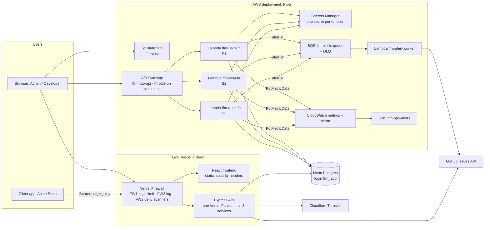
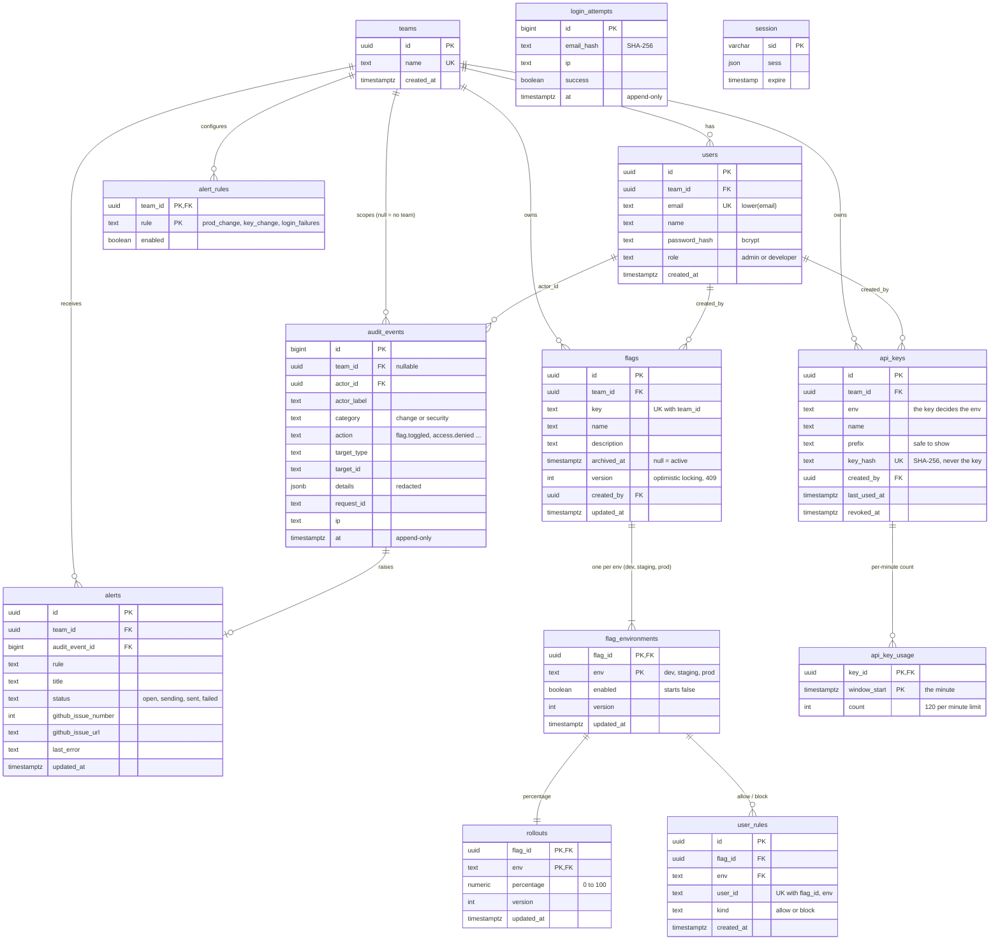
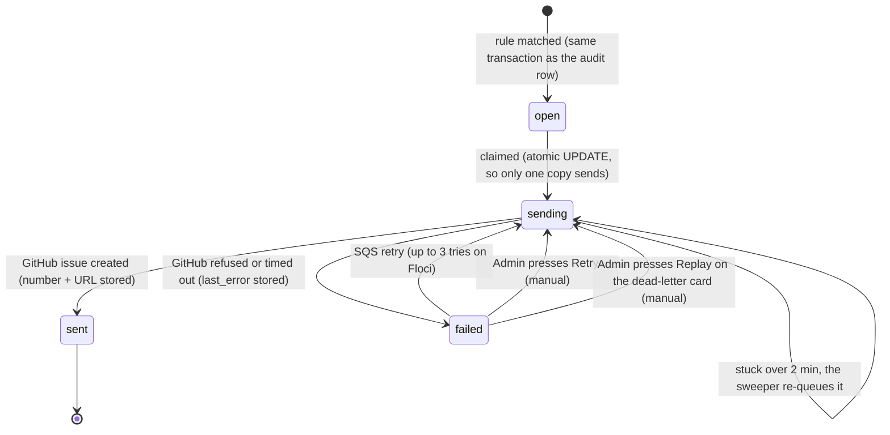
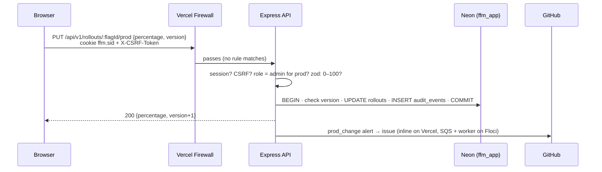
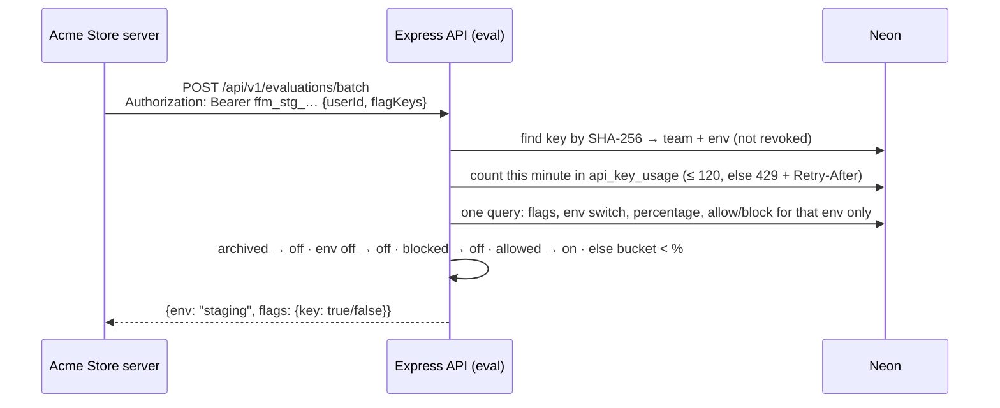

# Architecture: Feature Flag Manager

How the system is built, where it runs, how a request travels through it, and why it was built
this way. The threats and the controls that answer them are in [`threat-model.md`](threat-model.md);
every endpoint is in [`api-contract.md`](api-contract.md).

## 1. What the system does

Teams use the Feature Flag Manager to switch features on and off per environment (`dev`, `staging`,
`prod`) and roll them out to a percentage of users without redeploying. Every change is audited,
and security events raise alerts.

| Who | How they use it | Role |
|---|---|---|
| **Admin** | Signs in to the web app. Manages flags, rollouts and rules in every environment, including `prod`; exports the audit log; sees monitoring and alerts. | `admin` |
| **Developer** | Signs in to the web app. Works on flags in `dev` and `staging`; can read `prod` but cannot change it. | `developer` |
| **Client app** | A team's own application (here: the Acme Store demo). Asks "is this flag on for this user?" with an API key, no login. | API key, scoped to one team and one environment |

Roles live in `users.role` and are checked by the backend (`requireRole()` in
`backend/middleware/auth.js`), never only by the frontend.

## 2. Two deployments of the same code

| | Live (public) | AWS deployment |
|---|---|---|
| Where | Vercel + Neon | Floci (AWS emulator, `localhost:4566`) + the same Neon database |
| URL | https://feature-flag-manager-cyan.vercel.app | `http://ffm-web.s3-website.localhost.floci.io:4566` |
| Backend | One Vercel Function running all three services (`api/index.js` → `backend/app.js`) | Three Lambdas, one per service, behind API Gateway (`backend/lambdas/*.js`) |
| Built by | Git push → Vercel build (`vercel.json`) | Scripts: `infra/floci/services/s2-lambdas.sh`, `s3-audit.sh` |
| Secrets | Vercel environment variables (Sensitive) | AWS Secrets Manager, one secret per function |

Both start from `buildApp()` in `backend/build-app.js`. Vercel calls it with all three services;
each Lambda calls it with only its own service. Every AWS call in the code is switched on by an
environment variable (`ALERTS_QUEUE_URL`, `METRICS_NAMESPACE`, ...), so Vercel keeps working
with none of them set.

## 3. The three layers

### Frontend

React + Vite single-page app in `frontend/`, built to `frontend/dist`. Pages: sign-in (with the
Turnstile widget), flags list and flag page (S1), rollout page with percentages, allow/block lists
and a preview tool (S2), audit log and monitoring page (S3). It talks only to `/api/v1` on its own
origin, so the session cookie can be `SameSite=Strict`. On Vercel the security headers
(CSP, HSTS, `X-Frame-Options: DENY`, `nosniff`, Referrer-Policy, Permissions-Policy, COOP) come
from `vercel.json`. The frontend hides buttons a user may not use, but that is only for comfort:
every rule is checked again by the backend.

### Backend: three services

Express 5, one folder per service in `backend/services/`, each with routes → controller (zod
validation, status codes) → SQL. Shared middleware: `helmet`, request logger (never logs bodies),
415 check, 10 kB body limit, session, CSRF, 404 and the central error handler.

| Service | Owner | Main functions | Talks to |
|---|---|---|---|
| Identity + Flag Management (`auth`, `flags`) | S1 Youssef | sign-in / sign-out / me, create, list, search, edit, archive, delete, toggle per environment | calls S2's `rollouts.createDefaults()` when a flag is created; every change goes through S3's `audit.record()` |
| Rollout Service (`keys-evaluation`) | S2 Habiba | percentages per environment, allow/block lists, preview, `POST /evaluations` and `/evaluations/batch` for client apps, per-key rate limit | reads S1's flags and environments; writes audit events; a `prod` change raises S3's `prod_change` alert |
| Audit and Monitoring (`audit-alerts`) | S3 Ebrahim | audit list / summary / CSV export, monitoring numbers, alert rules, alerts → GitHub issues, dead-letter replay | receives events from every service; GitHub Issues API; on Floci SQS, CloudWatch, SNS |

### Data: Neon Postgres

One database, reached by every service through the limited login `ffm_app` (rights in
`backend/db/grants.sql`). Migrations in `backend/db/migrations/` are applied by
`npm run migrate` as the owner; the app never runs as the owner.

| Table | Written by | Notes |
|---|---|---|
| `teams`, `users` | seed (S1 reads) | `users.role` = `admin` / `developer`; bcrypt password hashes |
| `session` | session store | server-side sessions, so a sign-out really ends the session |
| `login_attempts` | S1 | append-only for `ffm_app`; drives the lockout (5 failures per email or IP in 15 minutes) |
| `flags`, `flag_environments` | S1 | every row has `team_id`; `version` for optimistic locking |
| `rollouts`, `user_rules` | S2 | one rollout per flag and environment; allow/block entries |
| `api_keys`, `api_key_usage` | S1 creates keys, S2 checks them | only the SHA-256 of a key is stored; usage holds the per-minute count for the rate limit |
| `audit_events` | every service, through `shared/audit.js` | append-only for `ffm_app` (no UPDATE, DELETE or TRUNCATE) |
| `alert_rules`, `alerts` | S3 | one alert per rule hit; its GitHub issue status |

Every query filters by the signed-in user's `team_id` (or the API key's team). An id from another
team gets `404`, so its existence is not revealed.

### Entity-relationship diagram

All tables from `backend/db/migrations/001`–`004` (the hand-made `sessions` table from 001 was
dropped in 002; express-session's `session` table replaced it). `team_id` on almost every table is
what keeps teams apart.

`login_attempts` and `session` have no foreign keys on purpose: an attempt is stored before anyone
is known (only a hash of the email), and the session store manages its own rows.
`ffm_app` may only INSERT and SELECT on `audit_events` and `login_attempts`, so the history cannot
be changed ([ST-10](../backend/shared/__tests__/audit-grants.db.test.js)).

### Alerts: automatic and manual

An alert is raised **automatically** in the same transaction as the audit row that matched a rule
(`alerts.raiseFor` in `shared/audit.js`). Delivery to GitHub then happens after COMMIT: inline on
Vercel, through the SQS outbox and `ffm-alert-worker` on Floci. Two **manual** actions exist for
Admins: **Retry** one failed alert, and **Replay** the team's dead letters.

A `sent` alert is never sent again: a second Retry returns the existing issue (`200`), and a
duplicate SQS message finds nothing to claim.

## 4. Request flows

### a. An Admin changes a rollout

A Developer making the same request gets `403 FORBIDDEN` before the database is changed, and the
denial is written to the audit log as `access.denied`.

### b. A client app asks for a flag

The environment comes **only from the key**. A body that sends `env` is rejected with `400`, so a
staging key can never read `prod`. Only on/off values leave the server: the rules and the
percentages stay private. The store keeps the key in its own server function, never in the
browser, and treats every error as "off" (fail closed).

### c. An alert on the AWS deployment

The request commits its change, puts only `{alertId}` on SQS `ffm-alerts-queue` and answers. The
worker Lambda `ffm-alert-worker` (the only identity that can read the GitHub token) opens the
issue. After 3 failed tries the message goes to the dead-letter queue, where an Admin can see and
replay it from the monitoring page. Security events also go to CloudWatch (`FFM/FailedLogins`,
`Forbidden`, `BotCheckFailures`, `ServerErrors`); the alarm `ffm-failed-logins` sends to SNS
`ffm-ops-alerts`. Details: [`infra/floci/services/README.md`](../infra/floci/services/README.md).

## 5. Environments and API keys

Each flag has three environment rows (`dev`, `staging`, `prod`), each with its own on/off switch,
percentage and allow/block list. A client app reads exactly one of them, chosen by its key:

| Key prefix | Reads |
|---|---|
| `ffm_dev_…` | the `dev` row |
| `ffm_stg_…` | the `staging` row (the Acme Store uses this one) |
| `ffm_prd_…` | the `prod` row |

`npm run check:envs` sends the same request with all three keys to the live API and prints the
three answers side by side (`tests/env-check/check-envs.js`).

## 6. Trust boundaries

| Boundary | What crosses it | What is checked there |
|---|---|---|
| Internet → Vercel edge | every request | Vercel DDoS protection; firewall rules FW1–FW3; managed OWASP rules (log) |
| Edge → API | browser and client-app requests | JSON only (415), 10 kB limit, session or API key, CSRF on writes, role, zod schema, team ownership |
| API → database | SQL | parameterised queries only; login `ffm_app` without owner rights |
| API → GitHub / Turnstile | outbound HTTPS | tokens from environment variables or Secrets Manager; timeouts; failures never break the request |
| Lambda → AWS services (Floci) | Secrets Manager, SQS, CloudWatch | one IAM role per function, exact resource ARNs ([`infra/iam/README.md`](../infra/iam/README.md)) |
| Developer machine → repo | code | CI: tests, migrations, gitleaks over the full history, npm audit; `protect-main` ruleset |

## 7. AWS services per student (Floci)

| Student | Counted services | What they do |
|---|---|---|
| S1 Youssef | S3 snapshots, KMS, EventBridge | planned: versioned, encrypted flag history and restore; prod changes as events |
| S2 Habiba | API Gateway, Secrets Manager, Lambda `ffm-eval-fn` | the route table and evaluation throttle for every function; one secret per function with a resource policy; S2's own function |
| S3 Ebrahim | SQS (+ DLQ), CloudWatch, SNS | the alert outbox and its worker; security metrics and the failed-login alarm; alarm delivery |

IAM is used by everyone but not counted. Also on Floci: S3 static site `ffm-web` (S2) and the
Lab 8 setup (ECS, load balancer, auto scaling, CloudWatch Logs) in
[`infra/floci/lab8/README.md`](../infra/floci/lab8/README.md).

## 8. Why this cloud model

| Choice | Why | Trade-off |
|---|---|---|
| **Serverless functions** (Vercel Function, AWS Lambda) | No servers to patch, scales with traffic, free at coursework scale, deploys on every push | Cold starts; each copy opens its own small database pool, so Neon's connection limit is the ceiling (measured in [`load-test-results.md`](load-test-results.md)) |
| **Managed Postgres** (Neon) | Real SQL with transactions, row ownership and grants; branching for restore | An external provider; free-tier limits |
| **One function per service on AWS** | Each service gets only its own secret and IAM rights, scales on its own, and has its own logs | More moving parts than one function; all three still share one database login |
| **Vercel stays the live app** | Public HTTPS URL, firewall and deployment protection without running AWS for real | Two deployments to keep in step; scripts rebuild Floci from the repo so they stay the same code |
| **Evaluation on the server, not in an SDK** | Rules and percentages stay private; one place to rate-limit and audit | One HTTP request per page; reduced by the batch endpoint |

Shared responsibility: Vercel, Neon and AWS run the platform, the network edge, encryption at rest
and patching of their services. The team is responsible for the code, the access rules, the
secrets, the firewall rules, the IAM policies and watching the logs.

## 9. Known limits

- Floci stores IAM policies, secret resource policies and the gateway throttle but does not say it
  enforces them. Postgres does enforce `ffm_app`'s limits, so those are shown live.
- The Vercel free plan allows one edge rate-limit rule; it is used for login (FW1). Evaluations
  are limited by the app (120 per minute per key) and, on Floci, by the API Gateway throttle.
- All services share the `ffm_app` login. A login per service would contain a bug in one service.
- S1's AWS services and the `/keys` endpoints are not built yet; keys are created with
  `npm run seed:key` until then.
